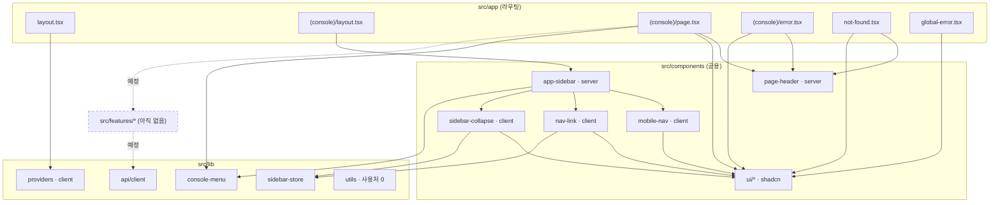
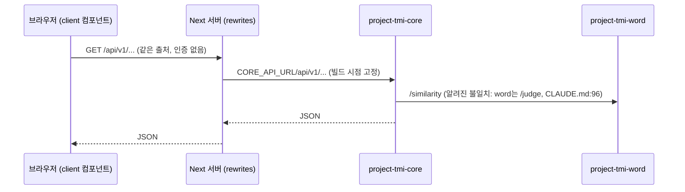

# 03. 코드 구조 점검

대상 커밋: `86e86bf`. 발견 ID는 `CS-xx`. 제품 코드는 셸 + 홈 화면 1개이고 BE 호출 화면은 없다(`src/features/` 없음). 그래서 이 문서의 상당 부분은 "지금 구조가 첫 데이터 기능을 받을 준비가 됐는가"를 본다.

## 요약

- 폴더 구조와 Server/Client 경계는 CLAUDE.md의 설계와 거의 일치하고, client 파일은 상태가 필요한 말단 부품으로 좁혀져 있다(6개).
- **배포 전 막아야 할 구조적 위험이 하나 있다**: 인증이 없는 상태에서 `next.config.ts` rewrites가 `/api/v1/*` 전체를 core로 중계하므로, VM이 공개되면 core API가 인터넷에 그대로 열린다(CS-01).
- 테스트가 전혀 없고(CS-02), API 클라이언트는 오류 정규화가 비어 있으며 "404를 빈 상태로 바꾸는 위치"도 정해져 있지 않아, 첫 데이터 기능에서 화면마다 오류 처리가 달라질 구조다(CS-03, CS-04, CS-11).
- 각 발견의 해결 제안은 9절 표의 "대응" 열에 `05-proposals.md`의 P-xx와 `decisions-needed.md`의 D-xx로 적었다.

## 1. 폴더 구조 (실제)

```
src/
├── app/
│   ├── (console)/          layout.tsx · page.tsx                    # 셸 + 홈
│   │                       error.tsx (client, Next 규약)
│   ├── global-error.tsx (client, Next 규약)
│   ├── not-found.tsx · layout.tsx · globals.css · favicon.ico
├── components/
│   ├── app-sidebar.tsx (server) · page-header.tsx (server)
│   ├── mobile-nav.tsx · nav-link.tsx · sidebar-collapse.tsx (client)
│   └── ui/                 badge · button · card · sheet            # shadcn 생성물
└── lib/
    ├── api/client.ts       # HTTP 클라이언트(호출처 0)
    ├── console-menu.ts · env.ts(빈 객체) · providers.tsx(client) · sidebar-store.ts · utils.ts(사용처 0)
```

CLAUDE.md 트리(`CLAUDE.md:49-63`)와의 차이: `components/`에 `mobile-nav`·`sidebar-collapse` 미기재, `lib/`에 `sidebar-store.ts`·`utils.ts` 미기재, Zustand store가 `features/<name>/store.ts`가 아닌 `lib/`에 있음(라우트를 넘는 셸 상태라 `lib/`가 타당하지만 트리에 규정이 없음). → `01-ai-setup.md` AI-07과 같은 건.

## 2. 라우팅

| 항목 | 현황 | 근거 |
|---|---|---|
| 라우트 | `/`(홈) 하나 + 404 | `pnpm build` 출력: `○ /`, `○ /_not-found` |
| 셸 | 라우트 그룹 `(console)`의 `layout.tsx`가 사이드바 + `main` | `src/app/(console)/layout.tsx:5-13` |
| 타입 안전 링크 | `typedRoutes: true`, 메뉴 `href?: Route` | `next.config.ts:11`, `src/lib/console-menu.ts:12` |
| 404 | 루트 `not-found.tsx`. 콘솔 셸 밖에서 렌더(사이드바 없음) | `src/app/not-found.tsx:9-23`, 스크린샷 `02-nope@1280.png` |
| 메타데이터 | 루트 템플릿 `"%s · TMI 콘솔"`, 화면별 `title` | `src/app/layout.tsx:14`, `(console)/page.tsx:8` |

- 사실: 루트 `src/app/not-found.tsx`는 `(console)` 그룹 밖에 있어 `(console)/layout.tsx`(사이드바 셸)가 적용되지 않는다. 그래서 404만 사이드바 없이 다른 여백으로 그려진다(CS-08, `02-design-system.md` DS-03과 같은 건, 둘 다 낮음).
- 이 문서는 어느 방식이 나은지 판단하지 않고 선택지를 `decisions-needed.md` D-07로 넘긴다.
  - A 현행 유지
  - B `PageContainer`로 폭·여백만 통일(사이드바 없음 유지). 추천(`05-proposals.md` P-D2)
  - C 셸을 루트 레이아웃으로 이동. 레이아웃 구조 변경이라 영향 범위가 크다
  - D `(console)/[...rest]/page.tsx`에서 `notFound()`를 부르고 `(console)/not-found.tsx`를 두어 셸 안에서 404를 그림. 설치본 문서로 확인한 것(2라운드):
    - 매칭되지 않은 URL은 **루트** `not-found`만 받는다("the root `app/not-found.js` … handle any unmatched URLs", `not-found.md:133`). 그래서 그룹 안 `not-found.tsx`만으로는 부족하고 catch-all 라우트가 필요하다.
    - 배열형 rewrites는 "after checking the filesystem … and before dynamic routes"(`rewrites.md:48`) 적용되므로 catch-all이 `/api/v1/*` 중계를 가로채지 않는다(`next.config.ts:12-14`는 배열형).
    - **대가**: catch-all이 생기면 `typedRoutes`가 `/${CatchAllSlug}` 형태의 경로 타입을 만들어(`node_modules/next/dist/server/lib/router-utils/typegen.js:165`) 아무 문자열 href나 타입 검사를 통과한다. `next.config.ts:10` 주석이 말하는 "메뉴 href 오타를 typecheck에서 잡는" 방어가 사라진다.
    - 실제 동작(빌드·화면)은 이 점검에서 돌려 보지 않았다.

## 3. 상태 관리

| 종류 | 위치 | 판단 |
|---|---|---|
| 서버 데이터 | TanStack Query `QueryClient`(`staleTime: 30_000`, `retry: 1`) | `src/lib/providers.tsx:8-18`. 사용처 아직 0 |
| 라우트를 넘는 UI 상태 | Zustand `useSidebarStore`(persist + `skipHydration`, 첫 렌더 뒤 `rehydrate()`) | `src/lib/sidebar-store.ts:12-20`, `src/components/sidebar-collapse.tsx:14-16`. hydration 불일치를 피하는 올바른 방식. 실측: 새로고침 후 접힘 유지(`screenshots/pw-report.json`의 `"collapsedAfterReload": 1`, `screenshots/pw-sidebar-collapsed@1280.png`) |
| 컴포넌트 지역 상태 | `useState`(모바일 서랍 열림) | `src/components/mobile-nav.tsx:11` |

- L3 규칙(`CLAUDE.md:68`)과 실제가 일치한다.
- 디자인 문서는 "조건에 맞는 데이터가 없다는 404는 빈 상태로 그린다"(`docs/design-system.md:44`)고 한다. 그런데 `client.ts:34-36`은 404도 `ApiError`로 던지므로 `useQuery`는 `isError`가 되어 **실패 화면**으로 간다. 404를 빈 값으로 바꾸는 위치(`features/<name>/api.ts`에서 바꿀지, 컴포넌트에서 `error.status`로 분기할지)가 정해져 있지 않다. → CS-04
- 부수 문제: `retry: 1`은 4xx에도 적용되어 404·400도 1회 재시도한다. TanStack Query v5 기본 `retryDelay`는 첫 재시도 1초다(설치본 `@tanstack/query-core@5.101.4` `src/retryer.ts:49-50`, `04-research.md` 부록 A). 즉 위치를 정한 뒤에도 재시도를 빼지 않으면 약 1초 늦게 그려진다.

## 4. API 호출 계층

```ts
// src/lib/api/client.ts:21-41 (발췌)
const res = await fetch(path, { ...rest, headers: { ...(body !== undefined && { "Content-Type": "application/json" }), ...headers }, ... });
if (!res.ok) {
  const errorBody = await res.json().catch(() => null);
  throw new ApiError(res.status, errorBody);
}
if (res.status === 204) return undefined as T;
return res.json() as Promise<T>;
```

| 관점 | 현황 | 평가 |
|---|---|---|
| 경유 강제 | `fetch`·`XMLHttpRequest`·`EventSource`·`globalThis.fetch` 직접 사용 금지, 허용은 `src/lib/api/**/*.{ts,tsx}`·`src/features/*/api.ts`·`src/features/*/api/**/*.{ts,tsx}` 세 경로뿐 | 강함(`eslint.config.mjs:164-186`, 허용 경로 `:310-314`) |
| 호출 경로 | 같은 출처 `/api/v1/*` → rewrites → `CORE_API_URL` | `next.config.ts:7-14`. CORS·주소 노출 문제를 없앤 좋은 결정(`3309ac0` 본문) |
| 서버 측 호출 | 상대 경로라 서버 컴포넌트에서는 쓸 수 없음 | 의도된 제약(`client.ts:18-19` 주석). CLAUDE.md도 클라이언트 페칭만 허용(`:66`) |
| 오류 모델 | `ApiError(status, body: unknown)`, 메시지는 영어 `"API request failed with status N"` | **정규화 없음.** BE 오류 형식(`body`) 해석과 사용자 문구 변환이 화면마다 생길 구조(CS-03). 404도 같은 `ApiError`라 빈 상태로 바꿀 위치가 없음(CS-04) |
| 응답 검증 | `res.json() as Promise<T>` 캐스팅 | 런타임 검증 없음. CLAUDE.md가 "추측해도 verify는 green"(`:95`)이라 경고하는 위험이 그대로 남음 |
| 타임아웃·취소 | 기본 없음. `signal`은 `...rest`로 전달 가능 | TanStack Query의 `signal`을 `api.ts`에서 넘기는 관례가 문서에 없음(CS-11) |
| `ApiError` 밖 예외 | 네트워크 실패는 `fetch`의 `TypeError`, 200 + 빈 본문은 `client.ts:40` `res.json()`의 `SyntaxError` | 오류 정규화 경로 밖이라 화면에 "Unexpected end of JSON input" 같은 원문이 나올 수 있음. BE가 200 + 빈 본문을 주는지는 확인 불가(CS-11) |
| `CORE_API_URL` | 빌드 시점 고정, 없으면 `http://localhost:8080` | `next.config.ts:6-7`, `.env.example:4` 주석 "실측: 실행 시 값을 바꿔도 반영 안 됨". VM 빌드 때 변수를 빠뜨려도 경고 없이 기본값으로 빌드되고, 실행 중에는 바로잡을 수 없음(CS-12) |

## 5. 인증 처리

- **없음.** CLAUDE.md "미정"에 "인증/세션 방식(VM은 인터넷에 노출됨, 배포 전 필수)"(`CLAUDE.md:100`).
- 구조적 함의: rewrites는 경로만 보고 중계하므로(`next.config.ts:13` `{ source: "/api/v1/:path*", destination: \`${coreApiUrl}/api/v1/:path*\` }`), FE를 공개하는 순간 core의 `/api/v1/*` 전체가 인증 없이 공개된다. 토스 자산 데이터(`src/lib/console-menu.ts:29-31` "토스 증권 계좌의 보유 종목과 평가금액")가 이 경로로 나갈 예정이다. → CS-01
- FE 단독으로 가능한 최소 방어(예: Next 16 `proxy.ts`(구 middleware, `node_modules/next/dist/docs/01-app/03-api-reference/03-file-conventions/proxy.md:11` "The `middleware` file convention is deprecated and has been renamed to `proxy`")에서 Basic 인증, 리버스 프록시 인증)와 BE 인증 중 무엇으로 갈지는 사용자 결정 사항이다 → `decisions-needed.md` D-01.

## 6. 에러 처리

| 층 | 파일 | 동작 |
|---|---|---|
| 데이터 오류 | (규칙) 각 컴포넌트의 `isPending`/`isError` 3상태 | `CLAUDE.md:67`. 구현 사례 0 |
| 렌더 버그 | `src/app/(console)/error.tsx`(client, Next 규약) | `useQueryErrorResetBoundary().reset()` 후 `retry()`(`:33-36`). Next 16.3의 `retry` prop은 설치된 문서와 일치(`node_modules/next/dist/docs/01-app/03-api-reference/03-file-conventions/error.md:117-121`, `:331` "v16.3.0 `retry` prop became stable") |
| 루트 레이아웃 오류 | `src/app/global-error.tsx`(client, Next 규약) | html·body·다크 클래스를 직접 넣음(`:16-17`) |
| 없는 주소 | `src/app/not-found.tsx` | 한국어 404 + 홈 버튼 |

- `error.tsx`는 client 오류일 때 `error.message` 원문을 화면에 보인다(`error.tsx:27`). 개인 콘솔이라 디버깅에 유리하지만, 공개 배포 시에는 노출 정보가 된다(CS-09, 낮음). 인증 도입·공개 배포(P-C1) 때 함께 처리하고, 그 전에는 개인 사용이라 유지한다.
- `useQueryErrorResetBoundary`는 `throwOnError`/Suspense 쿼리에서 던진 오류를 다시 던지지 않게 초기화하는 장치다. 규칙상 `throwOnError`·Suspense(`useSuspenseQuery`)를 쓰지 않으므로(`CLAUDE.md:66-67`) 현재 이 초기화가 필요한 도달 경로는 없다. 반면 `error.tsx:16` 주석은 "retry()만으로는 TanStack Query 캐시의 에러가 다시 던져지므로 먼저 초기화한다(실측)"고 적는데, 어떤 조건(예: `throwOnError` 실험)에서 실측했는지는 저장소에 남아 있지 않아 확인할 수 없다. 주석과 이 판단이 엇갈리는 부분은 확인 불가로 둔다. 코드는 무해하므로 조치하지 않는다.

## 7. 테스트 구성

- 테스트 러너·테스트 파일·CI 설정 모두 없음(`package.json:5-14`, 저장소에 `.github/` 없음).
- 검증은 `typecheck`·`lint`·`build`(Stop hook)와 `pnpm shot`(정적 촬영)뿐이다. 순수 로직(예정된 `src/lib/format.ts`의 만·억 내림 축약, `docs/design-system.md:49`)이나 API 클라이언트 분기(204, 오류 본문)를 검증할 수단이 없다. → CS-02

## 8. 의존 방향과 레이어 경계

실측 import(`git grep '^import' -- src ':!src/components/ui'`):



런타임 호출 경로:



- 현재 위반 없음: `lib` → `components`/`app` 방향 import 0, `components` → `app` 0.
- 강제 범위: lint는 **feature 간** import만 막는다(`eslint.config.mjs:27-67`). `components`·`lib`가 `features`를 import하거나 `features`가 `app`을 import하는 역방향은 막지 않는다. feature가 생기기 전이라 지금은 위험이 낮다. → CS-07

## 9. 일관성이 깨진 지점과 기술 부채

심각도: 높음 = 배포·데이터 안전 / 중간 = 첫 데이터 기능 품질에 직접 영향 / 낮음 = 정리.

표의 "대응"은 `05-proposals.md`의 제안(P-xx)과 `decisions-needed.md`의 결정(D-xx)이다. "결정할 것 / 미룰 수 있나"는 사용자가 정할 내용과 늦춰도 되는 시점이다.

| ID | 심각도 | 내용 | 근거 | 언제 터지나 | 대응(P-xx/D-xx) | 결정할 것 / 미룰 수 있나 |
|---|---|---|---|---|---|---|
| CS-01 | 높음 | 인증 없이 rewrites가 core API 전체를 공개 중계 | `next.config.ts:12-14`, `CLAUDE.md:100` | VM 공개 배포 시 | P-C1, D-01 | 인증 방식(리버스 프록시 Basic 인증 / Next 16 `proxy.ts` / BE 인증) 선택. 배포 전까지 미룰 수 있으나 배포 전 필수 |
| CS-02 | 중간 | 테스트 러너·테스트 0 | `package.json:5-14` | 첫 순수 로직(`format.ts`)·API 분기 작성 시 | P-C3, D-03 | 테스트 도입 여부와 범위(Vitest 로직·3상태). 다음 기능 전에 결정 |
| CS-03 | 중간 | `ApiError` 정규화·사용자 문구 변환 없음, 응답 런타임 검증 없음 | `src/lib/api/client.ts:1-10`, `:34-40` | 첫 데이터 화면의 실패 상태 작성 시 | P-C2 | 오류 문구 헬퍼(`errorMessage(e)`)를 첫 기능에 넣을지. 첫 데이터 기능 커밋까지 미룰 수 있음 |
| CS-04 | 중간 | 404를 빈 상태로 바꾸는 위치가 정해지지 않음. `client.ts`가 404도 `ApiError`로 던져 `useQuery`가 `isError`(실패 화면)로 가므로, 디자인 규칙 "404는 빈 상태"를 지킬 경로가 없다. 부수적으로 전역 `retry: 1`이 4xx도 재시도해 약 1초 지연 | `src/lib/api/client.ts:34-36`, `docs/design-system.md:44`, `src/lib/providers.tsx:13-14` | 첫 목록·조회 화면 | P-C2 | 변환 위치. 추천: `features/<name>/api.ts`에서 "없음"을 뜻하는 404만 빈 값으로 바꾸고 나머지는 throw, 4xx는 재시도 제외. 첫 목록·조회 화면 전에 결정 |
| CS-05 | 낮음 | `src/lib/utils.ts`(clsx+tailwind-merge `cn`)가 사용처 0인데 lint 설정이 이 파일만 예외 처리. shadcn 생성물은 npm `cn` 패키지(`package.json:20`, `node_modules/cn/package.json` description "Drop-in replacement for clsx + tailwind-merge")를 사용. `clsx`·`tailwind-merge`는 `utils.ts`에서만 쓰임 | `src/lib/utils.ts:4`, `eslint.config.mjs:261`, `src/components/ui/button.tsx:3`, `components.json:17` (`"utils": "@/lib/utils"`) | 새 직접 작성 컴포넌트가 어느 `cn`을 쓸지 갈릴 때 | P-C6 | 새 래퍼도 생성물처럼 `cn` 패키지를 쓰도록 권장. `utils.ts` 삭제 시 `clsx`·`tailwind-merge` 의존성도 제거 후보. `components.json:17` alias 영향은 적용 시 다음 `shadcn add` 때 확인. 첫 기능 뒤 정리 |
| CS-06 | 낮음 | 아키텍처 문서 트리와 실제 불일치 | 1절 | 다음 AI 세션이 트리를 근거로 파일 위치를 정할 때 | P-A7(AI-07과 같은 건) | 결정할 것 없음(사실 정정). 지금 |
| CS-07 | 낮음 | 단방향 의존 규칙(app → features → components/lib) 미강제 | `eslint.config.mjs:27-67` | feature가 2개 이상 생긴 뒤 | P-C5 | lint 규칙 추가 여부. 첫 기능 뒤 정리 |
| CS-08 | 낮음 | 404가 셸 밖(사이드바 없음, 다른 여백). DS-03과 같은 건(시각 불일치) | `src/app/not-found.tsx:11`, `02-design-system.md` DS-03 | 지금(시각 불일치) | P-D2-C, D-07 | 2절 선택지 A~D 중 선택(추천 B). 여유 있을 때, 늦어져도 기능 영향 없음 |
| CS-09 | 낮음 | client 오류 시 `error.message` 원문 노출 | `src/app/(console)/error.tsx:27` | 공개 배포 시 | P-C1과 함께 | 인증 도입·공개 배포 때 함께 처리. 그 전에는 개인 사용이라 유지 |
| CS-10 | 낮음 | 호출처 없는 선행 코드(`apiClient`, 빈 `env`)가 "미리 만들지 않는다"(`CLAUDE.md:8`)와 긴장 관계 | `src/lib/api/client.ts`, `src/lib/env.ts:4` | 영향 작음. 첫 기능에서 실제 형태가 정해질 때 재검토 | P-C6 | 결정할 것 없음. 첫 기능 때 재검토 |
| CS-11 | 낮음 | `ApiError`가 아닌 예외(네트워크 `TypeError`, 200 + 빈 본문 `SyntaxError`)가 정규화 밖. 타임아웃·`signal` 전달 관례 없음 | `src/lib/api/client.ts:24`, `:40`, 4절 | 첫 데이터 화면에서 네트워크 끊김·빈 응답 시 | P-C2(`errorMessage`가 이 예외도 처리), P-C4(`queryOptions`의 `queryFn: ({ signal }) => …`로 `signal` 전달) | P-C2·P-C4에 포함할지. P-C4 방식은 D-04 결정에 따름. 첫 데이터 기능 전 |
| CS-12 | 낮음 | `CORE_API_URL`이 없으면 조용히 `localhost:8080`으로 빌드되고 빌드 시점에 고정되어 배포 때 누락을 알 수 없음 | `next.config.ts:6-7`, `.env.example:4` | VM 배포 빌드 시 | P-C7 | 프로덕션 빌드에서 `CORE_API_URL` 미설정 시 빌드를 실패시키는 가드를 넣을지. 배포 전 |

## 리뷰 반영 기록(라운드 1)

| # | 지적 요약 | 처리 | 위치 |
|---|---|---|---|
| 1 | 2절 "셸을 루트로 올려도 잃는 것이 없다(추정)"가 D-07과 반대, catch-all 선택지 누락, Next 문서 미확인 | 반영. 추정 결론 삭제, 사실만 남기고 선택지 A~D를 D-07로 넘김. D는 `not-found.md`·`route-groups.md` 확인 필요로 명시 | 2절 |
| 2 | 9절 표에 수정안·P-xx/D-xx 연결 없음 | 반영. "대응(P-xx/D-xx)"와 "결정할 것 / 미룰 수 있나" 열 추가. CS-09는 P-C1과 함께 처리로 명시 | 9절, 요약 |
| 3 | CS-04를 "1초 지연"으로만 봄. 본질은 404를 빈 상태로 바꿀 위치 미정 | 반영. CS-04 재정의, 추천 위치(`api.ts`에서 "없음" 404만 빈 값) 기재. 05 P-C2·examples 대조는 담당 파일 밖이라 이 문서에서는 P-C2 연결만 적음 | 3절, 4절 표, 9절 CS-04 |
| 4 | CS-08(낮음)과 DS-03(중간) 심각도 불일치 | 반영. CS-08 낮음 유지, DS-03과 같은 건으로 표기(DS-03도 낮음이 공통 기준) | 2절, 9절 CS-08 |
| 5 | 타임아웃·취소, 빈 본문 `SyntaxError`에 ID 없음 | 반영. CS-11(낮음) 신설, P-C2·P-C4 연결 | 4절 표, 9절 CS-11 |
| 6 | `CORE_API_URL` 조용한 기본값 누락 | 반영. CS-12(낮음) 신설, P-C7(배포 전 빌드 가드) 연결 | 4절 표, 9절 CS-12 |
| 7 | 허용 경로에 `features/*/api/**` 누락 | 반영. 세 경로 명시, `eslint.config.mjs:310-314` 인용 | 4절 표 |
| 8 | "Next middleware/proxy" 옛 용어 | 반영. "Next 16 `proxy.ts`(구 middleware)" + `proxy.md:11` 인용 | 5절 |
| 9 | `useQueryErrorResetBoundary` 판단이 `error.tsx:16` 주석과 충돌 | 반영. 규칙상 도달 경로 없음, 주석의 "실측" 조건은 확인 불가로 정리. AI-07 편입은 하지 않음(주석이 틀렸다고 확정할 근거 없음) | 6절 |
| 10 | 트리에 `error.tsx`·`global-error.tsx` client 표시 누락, CS-05에 의존성 제거 후보 누락 | 반영 | 1절 트리, 9절 CS-05 |
| 11 | 새로고침 후 접힘 유지 실측 출처 없음 | 반영. `pw-report.json`의 `collapsedAfterReload`, `pw-sidebar-collapsed@1280.png` 인용 | 3절 |

## 리뷰 반영 기록(라운드 2)

| # | 지적 요약 | 처리 | 위치 |
|---|---|---|---|
| 1 | 선택지 D의 typedRoutes 대가 누락 | 반영. catch-all 시 `CatchAllSlug`로 href 오타 방어가 사라짐을 명시(`typegen.js:165`) | 2절 D |
| 2 | D 방식 검증을 '미검증'으로 남김 | 반영. `not-found.md:133`(루트만 unmatched URL 처리 → catch-all 필요), `rewrites.md:48`(배열형 rewrites는 동적 라우트보다 먼저 → 충돌 없음)으로 결론. 빌드 실행은 미실시로 명시 | 2절 D |
| — | D-07 시점을 05·decisions와 통일 | 반영. CS-08 시점 '여유 있을 때', 대응 P-D2-C | 9절 CS-08 |

## 리뷰 반영 기록(05 라운드 3 교차 지적)

| # | 지적 요약 | 처리 | 위치 |
|---|---|---|---|
| 05-R3 #7 | CS-07 시점이 05와 다름 | 반영. '첫 기능 뒤 정리' | 9절 CS-07 |
